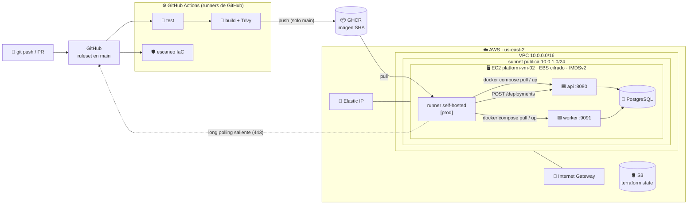
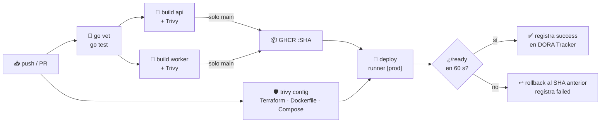

<div align="center">

# 🏗️ platform

### Plataforma DevOps end-to-end en AWS: infraestructura como código, configuración automatizada y CI/CD con despliegue y rollback automáticos.

[](https://github.com/martincitouU/platform/actions/workflows/ci.yaml)


[Arquitectura](#️-arquitectura) ·
[Pipeline](#-pipeline-de-cicd) ·
[Reproducir desde cero](#-reproducir-desde-cero) ·
[Seguridad](#-seguridad) ·
[Roadmap](#️-roadmap)

</div>

---

## ✨ ¿Qué es esto?

Una plataforma completa, definida en código, que lleva un servicio desde un `git push`
hasta producción en AWS sin pasos manuales.

El servicio que despliega es **[DORA Tracker](app/README.md)**, una API en Go que calcula
las cuatro métricas DORA (frecuencia de despliegue, lead time, tasa de fallos y MTTR).
El pipeline registra cada despliegue en el propio tracker, así que **la plataforma mide su
propio rendimiento de entrega**.

| Capa | Herramienta | Qué resuelve |
|---|---|---|
| ☁️ Infraestructura | **Terraform** | Red, firewall, VM e IP fija en AWS, reproducibles desde cero en minutos |
| 🗄️ State | **S3** | State remoto versionado, cifrado y con bloqueo nativo |
| 🔧 Configuración | **Ansible** | Docker, usuarios, permisos, firewall y runner, de forma idempotente |
| 🤖 CI/CD | **GitHub Actions** | Tests, escaneo de IaC, build, escaneo de imágenes, publicación y despliegue |
| 🐳 Ejecución | **Docker Compose** | API, worker y PostgreSQL en la VM |
| 📊 Medición | **DORA Tracker** | Métricas DORA de cada despliegue, listas para Prometheus |

---

## 🏛️ Arquitectura



**Decisiones clave:**

- **El runner va a buscar el trabajo.** El runner self-hosted abre una conexión *saliente*
  hacia GitHub, así que la VM no expone ningún puerto a internet salvo SSH para la IP del
  administrador.
- **El job de deploy pide etiquetas, no una máquina.** `runs-on: [self-hosted, prod]` lo
  toma cualquier runner online con esas etiquetas. Mover producción a otra VM fue registrar
  un runner nuevo, sin tocar el workflow.
- **Cada imagen se etiqueta con el SHA del commit.** Se sabe exactamente qué código corre
  en producción, y el rollback es volver al SHA anterior.

---

## 🤖 Pipeline de CI/CD



| Job | Corre en | Qué hace |
|---|---|---|
| `test` | GitHub | `go vet` y `go test` (sin base de datos) |
| `iac` | GitHub | `trivy config` sobre todo el repo; falla con hallazgos HIGH/CRITICAL sin excepción documentada |
| `build` | GitHub | Imágenes multi-stage distroless (matrix `api`/`worker`), escaneo con Trivy y publicación en GHCR solo desde `main` |
| `deploy` | VM (self-hosted) | Guarda el SHA actual, actualiza `IMAGE_TAG`, `pull` + `up -d`, espera `/ready`, hace rollback si falla y registra el resultado en el tracker |

El deploy usa `concurrency: deploy-prod` para que dos despliegues nunca se pisen.

---

## 🗂️ Estructura del repo

```
platform/
├── app/                       DORA Tracker (Go) → ver app/README.md
├── compose.yaml               producción: imágenes de GHCR por SHA
├── compose.dev.yaml           desarrollo: build local
├── .env.example               plantilla de secretos (el .env real nunca entra al repo)
├── infra/
│   ├── bootstrap/             bucket S3 del state (se aplica una vez, state local)
│   ├── terraform/
│   │   ├── backend.tf         state remoto en S3 con bloqueo nativo
│   │   ├── network.tf         VPC, IGW, subnet, rutas, default SG bloqueado
│   │   ├── compute.tf         SG, key pair, AMI, EC2, Elastic IP
│   │   ├── variables.tf       incluye my_ip_cidr validado como /32
│   │   └── outputs.tf         IP pública, ID de instancia, comando SSH
│   └── ansible/
│       ├── site.yml           configuración base de la VM
│       └── runner.yml         runner de GitHub Actions como servicio
├── .github/
│   ├── workflows/ci.yaml      pipeline completo
│   └── dependabot.yml         actualiza actions, módulos Go e imágenes base
└── learnings.md               bitácora de lo aprendido
```

---

## 🔁 Reproducir desde cero

**Requisitos:** Terraform ≥ 1.10, Ansible, AWS CLI con credenciales temporales
(`aws login`) y una llave SSH (`ssh-keygen -t ed25519 -f ~/.ssh/platform-tf`).

```bash
# 1. Bucket del state (solo la primera vez)
terraform -chdir=infra/bootstrap init && terraform -chdir=infra/bootstrap apply

# 2. Infraestructura (tu IP actual es la única que puede entrar por SSH)
export TF_VAR_my_ip_cidr="$(curl -s https://checkip.amazonaws.com)/32"
terraform -chdir=infra/terraform init
terraform -chdir=infra/terraform apply

# 3. Configuración de la VM
export VM_IP=$(terraform -chdir=infra/terraform output -raw public_ip)
cd infra/ansible
ansible-playbook site.yml

# 4. Secretos: copiar un .env (basado en .env.example) a /opt/dora/.env,
#    con dueño runner y permisos 600. Nunca pasa por el repo.

# 5. Runner (token de un solo uso desde Settings → Actions → Runners)
read -s RUNNER_TOKEN && export RUNNER_TOKEN
ansible-playbook runner.yml

# 6. Un push a main despliega.
```

Correr Ansible una segunda vez da `changed=0`: la VM ya está como describe el código.

---

## 🔐 Seguridad

| Área | Control |
|---|---|
| **Red** | SG con SSH solo desde la IP del administrador (`/32` validado en la variable) · salida limitada a TCP 80/443 · default SG sin reglas · `ufw` con `LIMIT` en SSH · puertos de la app solo en `127.0.0.1` |
| **Cómputo** | Disco EBS cifrado · IMDSv2 obligatorio (mitiga SSRF) · imágenes distroless sin root ni shell |
| **Identidad** | Credenciales temporales de AWS, sin access keys · `runner` sin sudo · token de registro efímero con `no_log` |
| **Cadena de suministro** | Actions fijadas por SHA · Dependabot · Trivy en imágenes y en IaC · `permissions` mínimos del `GITHUB_TOKEN` |
| **State** | Bucket S3 versionado, cifrado, solo HTTPS, sin acceso público, con bloqueo nativo y `prevent_destroy` |
| **Secretos** | `.env` fuera del repo con permisos 600 · `::add-mask::` en los logs del CI |

**Riesgos aceptados**, documentados junto al código que afectan:

- **Salida a `0.0.0.0/0` por 80/443** (`AWS-0104`): GitHub, GHCR y apt usan IPs cambiantes;
  se limitó a esos dos puertos.
- **State cifrado con SSE-S3 y no con una llave KMS propia** (`AWS-0132`): el acceso lo
  controlan IAM y la política del bucket; una CMK agrega costo sin beneficio real para un
  proyecto de una persona.
- **Runner self-hosted en un repo público:** un PR desde un fork podría modificar el workflow
  para ejecutar código en la VM. Mitigación: los workflows de PRs de colaboradores externos
  requieren aprobación manual, el job de deploy solo corre en `push` a `main` (protegido por
  un ruleset que exige PR y checks en verde) y el usuario `runner` no tiene sudo.

---

## 📊 Resultados

| | Lead time |
|---|---|
| Despliegue manual (línea base) | **28 min** |
<!-- | Pipeline automatizado | completar con el lead time medido | -->

---

## 🗺️ Roadmap

- [x] **Fase 1 · App en producción:** API y worker en Go, Docker multi-stage, Compose, CI/CD con rollback
- [x] **Fase 2 · Infraestructura como código:** Terraform, Ansible, migración de producción a la VM gestionada, state remoto en S3, escaneo de IaC
- [ ] Endurecimiento de SSH y `unattended-upgrades` en Ansible
- [ ] Pipeline de Terraform: `plan` en cada PR
- [ ] **Fase 3 · Kubernetes:** k3s, Helm, Argo CD (GitOps)
- [ ] **Fase 4 · Observabilidad:** Prometheus, Grafana, Alertmanager y dashboard DORA

---

<div align="center">

Hecho por [Martín](https://github.com/martincitouU) · Bitácora en [learnings.md](learnings.md)

</div>
